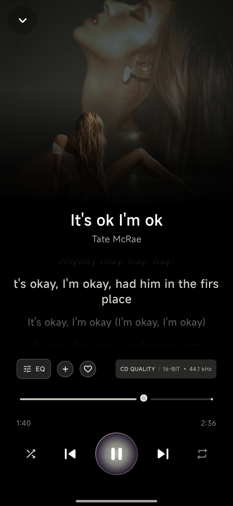
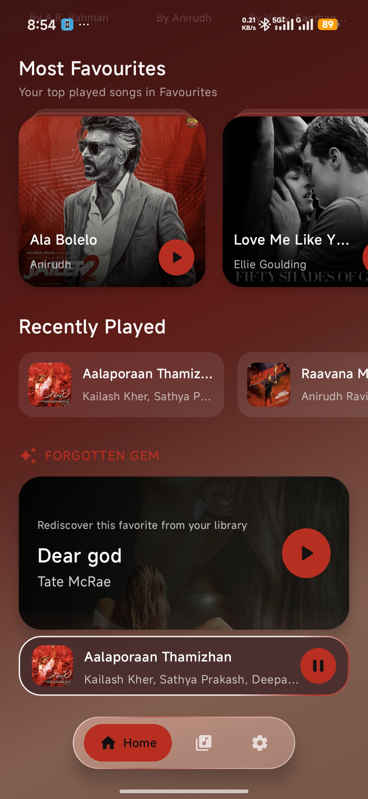
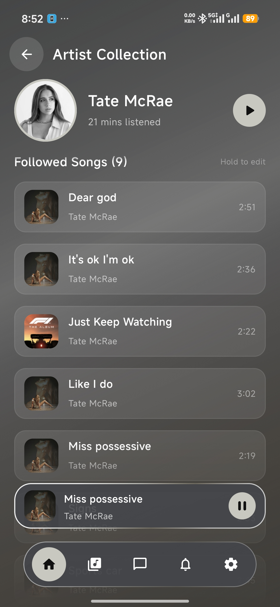
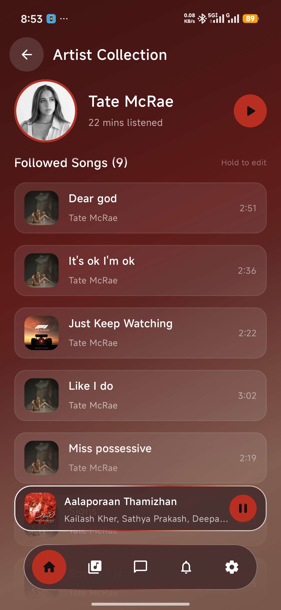
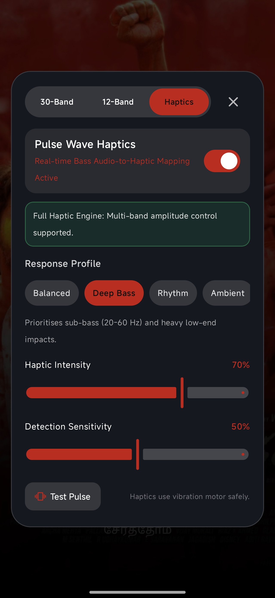
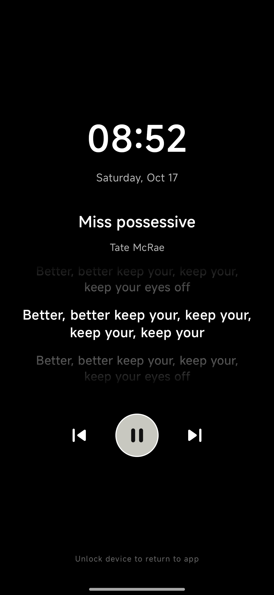
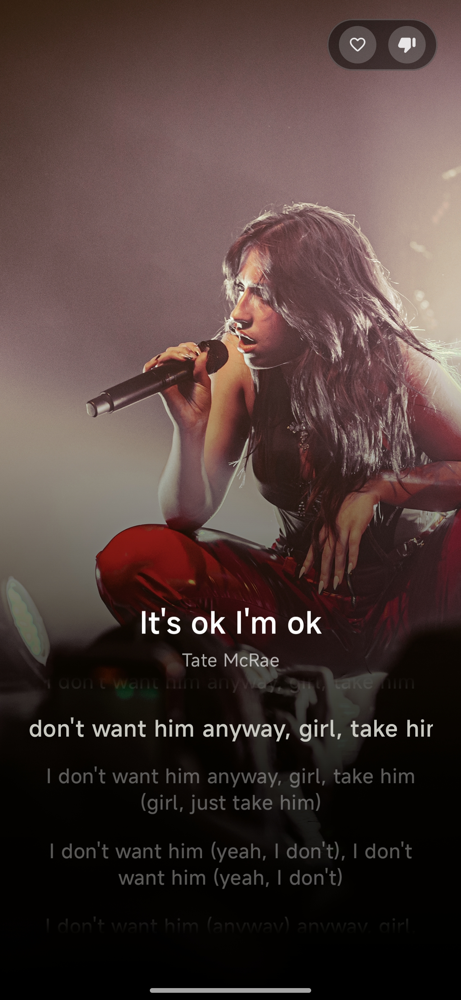

Morgan Play

A personal Android music player focused on audio quality, customization, and a better listening experience.

Morgan Play is an independent music player project currently under development.

Project Highlights

- Hi-res local PCM playback with no dB restrictions.
- 30-band Studio equalizer 
- Pulse Wave DSP — a developing custom audio-processing engine
- Auto fetch for Music's metadata and album artwork
- Auto Lyrics fetch support
- Custom Android media controls

Development

Morgan Play is actively evolving, with ongoing work on playback compatibility, audio processing, and interface improvements.

Downloads

Application releases will be announced here when available.

Source Code

This repository is a public project showcase. The complete application source code and proprietary implementations are not included.

---

Built with passion for music and audio technology.

## 📱 Screenshots

Explore the Morgan Play experience — from music discovery and artist pages to advanced audio processing and ambient screensavers.

### 🎵 Music Experience

  
  
  
  

### 🎚️ Audio & DSP

  
  

### 🌙 Always-On Display & Screensaver

  
  
  

  

